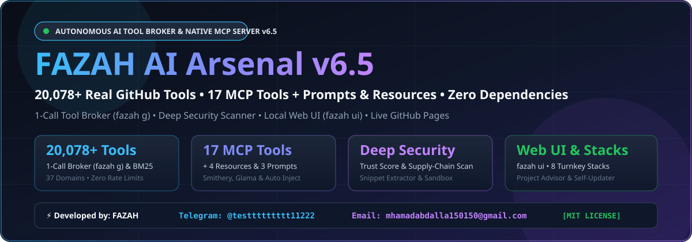
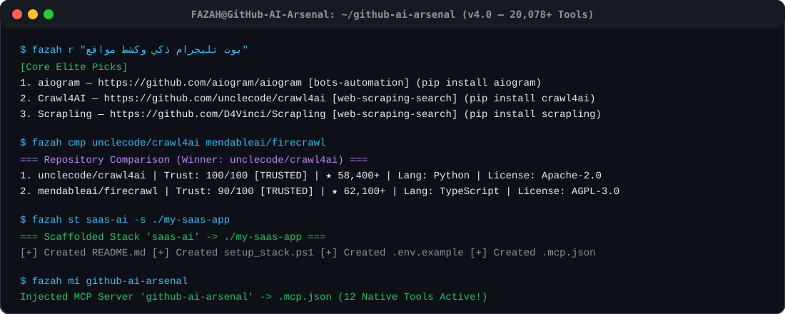

<div align="center">


<br/>

# ⚡ FAZAH AI Arsenal v6.5 (`github-ai-arsenal`)
### **Autonomous AI Tool Broker & 17-Tool Native MCP Server (+ Prompts & Resources) — 20,078+ GitHub Tools, 1-Call Delivery (`fazah g`), Code Snippet Extractor, Isolated Sandbox, Local Web UI & Security Scanner**

[](https://pypi.org/project/fazah-arsenal/)
[](https://hub.docker.com/r/fazaharsenal/github-ai-arsenal)
[](https://github.com/fazah-arsenal/github-ai-arsenal)
[](https://fazah-arsenal.github.io/github-ai-arsenal/)
[](scripts/mcp_server.py)
[-22c55e?style=for-the-badge&logo=python)](scripts/gh_arsenal.py)
[](scripts/gh_arsenal.py)
[](smithery.yaml)
[](https://t.me/testtttttttt11222)
[](https://t.me/testtttttttt11222)

> **FAZAH AI Arsenal (`github-ai-arsenal`)** is a zero-dependency **Universal Agent Skill (`SKILL.md`)**, **12-Tool Native Model Context Protocol (`MCP`) Server**, and ultra-short **`fazah` CLI** that equips **Claude Code, Cursor, Google Antigravity, DeepSeek Harness, Windsurf, and OpenAI Codex** with instant offline & online access to **20,078+ real, deduplicated GitHub repositories** across 37 engineering domains.



</div>

---

## 👨‍💻 Author & Official Contact

| Field | Details |
| :--- | :--- |
| **Creator & Lead Developer** | **FAZAH** |
| **Telegram** | [@testtttttttt11222](https://t.me/testtttttttt11222) |
| **Email** | [mhamadabdalla150150@gmail.com](mailto:mhamadabdalla150150@gmail.com) |
| **Official Repository** | [github.com/fazah-arsenal/github-ai-arsenal](https://github.com/fazah-arsenal/github-ai-arsenal) |

---

## 🌟 Why FAZAH AI Arsenal v6.5?

Instead of letting your AI agent reinvent existing tools from scratch or burn through GitHub API rate limits, **FAZAH AI Arsenal** bundles a compressed offline index of **20,078+ real, battle-tested GitHub repositories** alongside a pure-Python **BM25 search engine**, **Repository Trust & Security Auditor**, **Side-by-Side Comparison Engine**, and **1-Command Project Stack Scaffolder** — with **zero external Python dependencies**.

<div align="center">

</div>

### ✨ Key Capabilities:
1. **🔌 12-Tool Native MCP Server (`scripts/mcp_server.py`)**: Plugs directly into Antigravity, Claude Code, Cursor, Windsurf, and DeepSeek via standard `stdio JSON-RPC 2.0` — zero `pip install` required.
2. **⚡ Instant Offline BM25 Search (`fazah m` & `fazah r`)**: Search **20,078+ real GitHub repositories** across 37 domains in milliseconds with zero API rate limits (supports both English & Arabic prompts).
3. **🛡️ Security & Trust Auditor (`fazah a` & `fazah cmp`)**: Computes a **Trust Score (0–100)** checking stars, maintenance recency, SPDX license, and repository hygiene — plus side-by-side repo comparisons.
4. **🏗️ 1-Command Project Scaffolder (`fazah st <stack> -s <dir>`)**: Generates ready-to-run starter projects from 8 turnkey blueprints (`saas-ai`, `telegram-ai-bot`, `scraping-rag`, `security-pentest-lab`, `reverse-engineering-lab`, `desktop-app`, `voice-ai-agent`, `mcp-builder`).
5. **🚀 Smart Quickstart (`fazah q`)**: Auto-detects any repository's ecosystem (Python, Node, Rust, Go, Docker) and outputs exact install/run commands.
6. **💉 Auto MCP Injector (`fazah mi`)**: Safely injects any MCP server into `.mcp.json` with automatic `.bak` backup.
7. **⭐ Local Bookmarks (`fazah bm`)**: Save favorite repositories with custom notes for instant recall.
8. **📦 Pull & Install Without Git (`fazah p` & `fazah is`)**: Download any GitHub repo ZIP or install any repo as a local `SKILL.md` without requiring `git`.

---

## 🎬 Video Walkthrough (720p HD · Studio English Narration)

<div align="center">

<video src="https://github.com/fazah-arsenal/github-ai-arsenal/raw/main/assets/demo_walkthrough.mp4" controls="controls" width="100%" poster="assets/hero-banner.svg"></video>

<p align="center">
  <a href="https://github.com/fazah-arsenal/github-ai-arsenal/raw/main/assets/demo_walkthrough.mp4">
    <b>▶ Click here to view / download full MP4 video (3-Minute Live Demo)</b>
  </a>
</p>

> **Full 3-Minute Studio Walkthrough** with English voiceover covering:
> 1. **Overview & Architecture** (20,078 Tools, 5,306 MCP Servers)
> 2. **Downloading & Installing** (`pip install fazah-arsenal` & 1-line script)
> 3. **Zero-Touch MCP Auto-Link** (`fazah link` — auto-configures 7 MCP clients)
> 4. **Live MCP Client Demo** (Active stdio session: agent calls `search` → `audit` → `give`)
> 5. **Google Antigravity Integration** (Autonomous tool resolution & token saving)
> 6. **DeepSeek & Universal AI** (DeepSeek V3/R1, Claude, Cursor with 18 tools)
> 7. **Token & Quota Savings Tracker** (`fazah savings` — 320k+ tokens spared)
> 8. **Adaptive Error Memory & Self-Healing** (`fazah memory mistakes`)

</div>

---

## 🖥️ Live CLI Preview

<div align="center">

</div>

---

## ⚡ 1-Command Installation

### 🐍 PyPI (Cross-Platform — Recommended)
```bash
pip install fazah-arsenal
```
*Or run any command immediately without installing via `uvx`:*
```bash
uvx fazah-arsenal doctor
```

### 🐳 Docker (Instant Containerized MCP Server)
```bash
docker run -i --rm fazaharsenal/github-ai-arsenal
```

### Windows (PowerShell Installer)
```powershell
irm "https://raw.githubusercontent.com/fazah-arsenal/github-ai-arsenal/main/install.ps1" | iex
```
*(Or locally after downloading: `.\install.ps1`)*

### Linux / macOS
```bash
curl -fsSL "https://raw.githubusercontent.com/fazah-arsenal/github-ai-arsenal/main/install.sh" | bash
```
*(Or locally: `chmod +x install.sh && ./install.sh`)*

---

## 🔌 Connect as a Native MCP Server

Inject automatically into your workspace `.mcp.json`:
```bash
fazah mi arsenal
# Or use the full zero-touch auto-link command (injects into ALL clients at once):
fazah link
```

Or paste into your MCP client configuration (Antigravity, Claude Code, Cursor, Windsurf, DeepSeek):
```json
{
  "mcpServers": {
    "fazah-arsenal": {
      "command": "fazah-mcp",
      "args": []
    }
  }
}
```
> **Tip:** `fazah link` auto-detects and updates Claude Desktop, Cursor, Windsurf, Antigravity, VS Code Cline, VS Code Roo, and your current workspace `.mcp.json` in a single command — zero manual editing required.

### 🧰 18 Native MCP Tools (+ 5 Resources & 3 Prompts) Exposed:
| MCP Tool | Description |
| :--- | :--- |
| `arsenal_give_tool` | **1-Call Autonomous Tool Broker**: picks #1 tool, scans security, extracts code snippet & optionally pulls |
| `arsenal_get_snippet` | Extracts clean runnable code snippets from any README (saves 85% AI tokens) |
| `arsenal_deep_scan` | Deep supply-chain security scan of `setup.py`, `package.json`, `install.sh`, `Dockerfile` |
| `arsenal_analyze_project` | Scans local project directory & recommends missing GitHub tools & MCP servers |
| `arsenal_memory` | Persistent agent experience memory for verified working tools on this machine |
| `arsenal_recommend` | Intelligent tool recommender (Core Elite + 20,078+ Mega Index) |
| `arsenal_search_offline` | Instant offline BM25 search across 20,078+ repos with zero rate limits |
| `arsenal_stack` | Browse 8 turnkey project stacks with install commands |
| `arsenal_scaffold_stack` | Scaffold a complete starter project folder (`README.md`, `setup_stack`, `.env.example`, `.mcp.json`) |
| `arsenal_quickstart` | Auto-detect language/ecosystem and output exact install & run commands |
| `arsenal_compare` | Compare 2+ GitHub repositories side-by-side (Trust Score, Stars, License) |
| `arsenal_audit_repo` | Security & Trust Score (0–100) audit before pulling or running code |
| `arsenal_bookmark` | Add, list, or remove bookmarked favorite tools with notes |
| `arsenal_mcp_inject` | Safely inject any MCP server into `.mcp.json` with backup |
| `arsenal_inspect_repo` | Inspect repo metadata, top files, and `README.md`/`SKILL.md` without cloning |
| `arsenal_pull_repo` | Download and extract any GitHub repository ZIP without `git` |
| `arsenal_install_skill` | Auto-discover or synthesize `SKILL.md` and install any repo as a local skill |
| `arsenal_learn` | **Teach FAZAH a failure**: record a broken package + error + fix so future calls auto-avoid it |
| `arsenal_savings` | **Token & Quota Tracker**: exact tokens, USD, and API calls saved by using offline index + 1-call delivery |

---

## 🛠️ Ultra-Short CLI Cheatsheet (`fazah`)

```bash
fazah g "convert pdf to markdown"          # 1-Call Autonomous Tool Broker (pick + scan + snippet)
fazah g "web scraper" --pull               # Pick, security-scan & auto-download ZIP in 1 call
fazah sn unclecode/crawl4ai                # Extract clean runnable code snippets (saves 85% tokens)
fazah mem log unclecode/crawl4ai -t scrape # Log verified working tool into agent experience memory
fazah try unclecode/crawl4ai               # Pull into isolated Python venv sandbox safely
fazah ui                                   # Launch Interactive Local Web Dashboard (http://127.0.0.1:8765)
fazah az .                                 # Analyze current project & recommend missing tools/MCPs
fazah scan unclecode/crawl4ai              # Deep supply-chain security scan of setup.py/package.json
fazah doc                                  # Check local runtimes, skills & index health
fazah info                                 # Show breakdown of 20,078+ tools across 37 domains
fazah r "telegram bot and web scraping"    # Smart tool recommender (English & Arabic)
fazah m -q "postgres vector" -n 10         # Instant offline BM25 search across 20k+ repos
fazah q unclecode/crawl4ai                 # Auto-detect install & run commands
fazah a modelcontextprotocol/servers       # Security & Trust Score (0-100) audit
fazah cmp unclecode/crawl4ai mendableai/firecrawl   # Side-by-side repo comparison
fazah st list                              # List all 8 turnkey project stacks
fazah st saas-ai -s ./my-saas-app          # Scaffold a complete starter project
fazah bm add unclecode/crawl4ai -m "Best"  # Bookmark a favorite repository
fazah mi github-ai-arsenal                 # Auto-inject MCP server into .mcp.json
fazah link                                  # Zero-Touch: inject into ALL MCP clients at once
fazah t -t mcp                             # Fetch live trending GitHub repos
fazah s "deepseek coding agent"            # Live GitHub API search
fazah i danielmiessler/fabric              # Inspect repo structure & README without cloning
fazah p unclecode/crawl4ai -d ./tools      # Download & extract repo ZIP without git
fazah is anthropics/skills                 # Install any GitHub repo as a local SKILL.md
fazah savings                              # View token & quota savings dashboard (tokens saved, USD, API calls avoided)
fazah up                                   # Self-update FAZAH AI Arsenal & 20k+ index from GitHub
```

### 📦 Install via Python `pip`
```bash
pip install git+https://github.com/fazah-arsenal/github-ai-arsenal.git
```

*(Full command names like `fazah recommend` and `python scripts/gh_arsenal.py recommend` also work identically.)*

---

## 📊 Domain Coverage (20,078+ Real Indexed Repositories)

| Domain | Indexed Tools | Highlights |
| :--- | :---: | :--- |
| `mcp-servers` | **5,032** | Official & community MCP servers for DBs, browsers, cloud, filesystems |
| `go-systems` & `rust-systems` | **4,613** | High-performance systems, networking, CLI & infrastructure tools |
| `devops-cloud` & `cpp-systems` | **2,289** | Docker, Kubernetes, CI/CD, cloud-native & low-level C/C++ libraries |
| `machine-learning` & `ai-agents` & `ai-llm` | **1,452** | Multi-agent swarms, LLM routers, local inference, RAG & fine-tuning |
| `ui-frontend` & `javascript-web` | **1,418** | React, Next.js, Tailwind, shadcn/ui & modern frontend ecosystems |
| `media-audio-video` | **1,130** | Speech-to-Text (Whisper), TTS (Kokoro), video processing & FFmpeg tools |
| `security-pentest` & `osint-recon` & `reverse-engineering` | **778** | SAST scanners, secret hunters, APK/ASAR/binary decompilers & OSINT |
| `dotnet-csharp` / `python` / `java-jvm` / `php-web` / `mobile-desktop` / `blockchain-web3` | **2,650+** | Full-stack libraries, desktop GUIs, mobile apps, Web3 & game dev |

---

## 🧪 Running Automated Tests

```bash
python -m unittest tests/test_arsenal.py
```

**Current Test Suite: 14 tests, 100% passing.**

| Test | Status |
|:--|:--|
| `test_stats_has_over_20000_tools` | ✅ PASS |
| `test_doctor_command` | ✅ PASS |
| `test_mega_offline_search_and_ranking` | ✅ PASS |
| `test_recommend_arabic_and_english` | ✅ PASS |
| `test_stack_command` | ✅ PASS |
| `test_quickstart_and_bookmarks` | ✅ PASS |
| `test_audit_repo_offline_fallback` | ✅ PASS |
| `test_mcp_config_generator` | ✅ PASS |
| `test_native_mcp_server_stdio` | ✅ PASS |
| `test_give_snippet_and_memory` | ✅ PASS |
| `test_analyze_project_and_deep_scan` | ✅ PASS |
| `test_adaptive_error_learning_and_self_healing` | ✅ PASS |
| `test_zero_touch_mcp_auto_link` | ✅ PASS |
| `test_quota_and_token_savings_tracker` | ✅ PASS |

---

## 📞 Connect With the Developer

* **Author**: **FAZAH**
* **Telegram**: [@testtttttttt11222](https://t.me/testtttttttt11222)
* **Email**: `mhamadabdalla150150@gmail.com`

---

## 📄 License

Released under the **MIT License** — free for personal, open-source, and commercial AI workflows.
