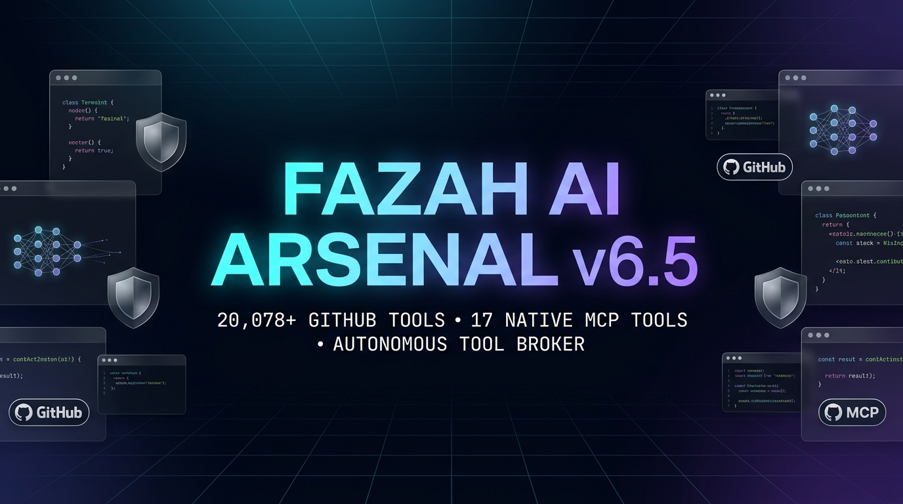
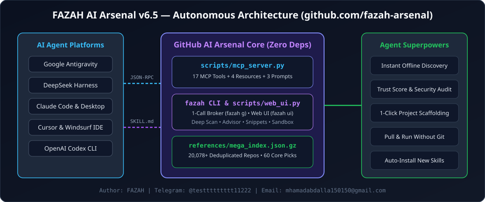

<div align="center">



<br/>

# ⚡ FAZAH AI Arsenal v4.0 (`github-ai-arsenal`)
### **The #1 Universal AI Agent Skill & Native MCP Server — 20,078+ Real Curated GitHub Tools, 5,000+ MCP Servers, Security Auditor & 1-Click Stack Scaffolder**

[](https://github.com/mhamadabdalla150150-blip/github-ai-arsenal)
[-8b5cf6?style=for-the-badge)](scripts/mcp_server.py)
[-22c55e?style=for-the-badge&logo=python)](scripts/gh_arsenal.py)
[](https://t.me/testtttttttt11222)
[](https://t.me/testtttttttt11222)

> **🇬🇧 English Bio:** **FAZAH AI Arsenal (`github-ai-arsenal`)** is a zero-dependency Universal Agent Skill (`SKILL.md`) and Native Model Context Protocol (`MCP`) Server that gives **Claude Code, Cursor, Google Antigravity, DeepSeek Harness, Windsurf, and OpenAI Codex** instant offline & online access to **20,078+ real, deduplicated GitHub repositories** across 37 engineering domains — complete with BM25 offline search, repository Trust Score (0–100) security auditing, side-by-side repo comparisons, and 1-command project scaffolding.

> **🇸🇦 نبذة المشروع (بالعربية):** **ترسانة الذكاء الاصطناعي الشاملة (FAZAH AI Arsenal v4.0)** هي أقوى مهارة ذكاء اصطناعي قياسية (`SKILL.md`) وسيرفر `MCP` أصلي مدمج يربط أي وكيل ذكاء اصطناعي (**Antigravity, DeepSeek, Claude Code, Cursor, Windsurf, Codex**) بأكثر من **20,078 أداة ومستودع GitHub حقيقي ومُصنّف** في 37 مجالاً، مع محرك بحث أوفلاين فائق السرعة (**BM25**) باللغتين العربية والإنجليزية، وفاحص أمان وموثوقية المستودعات، وباني مشاريع فوري بضغطة زر — **بدون أي مكتبات بايثون خارجية!**


</div>

---

## 👨‍💻 مطور المشروع (Author & Official Contact)

| البيان | التفاصيل |
| :--- | :--- |
| **اسم المطور (Creator & Lead Developer)** | **FAZAH** |
| **حساب تليجرام الرسمي (Telegram)** | [@testtttttttt11222](https://t.me/testtttttttt11222) |
| **البريد الإلكتروني للتواصل (Email)** | [mhamadabdalla150150@gmail.com](mailto:mhamadabdalla150150@gmail.com) |
| **المستودع الرسمي (GitHub Repository)** | [github.com/mhamadabdalla150150-blip/github-ai-arsenal](https://github.com/mhamadabdalla150150-blip/github-ai-arsenal) |

---

## 🌟 المعمارية الهندسية ولماذا يتفوق FAZAH AI Arsenal؟

<div align="center">

</div>

### ✨ المميزات الحصرية في الإصدار v4.0:
1. **🔌 سيرفر MCP أصلي مدمج (`scripts/mcp_server.py`)**: يوفر **12 أداة MCP جاهزة** عبر بروتوكول `stdio JSON-RPC 2.0` تعمل مع أي عميل MCP فور التثبيت بدون الحاجة لأي `pip install`.
2. **⚡ بحث أوفلاين فائق السرعة في +20,078 أداة (`mega` & `recommend`)**: خوارزمية ترتيب **BM25** مع قاموس مرادفات ثنائي اللغة (عربي / إنجليزي) بدون إنترنت وبدون استهلاك حدود GitHub API.
3. **🛡️ فاحص أمان وموثوقية المستودعات (`audit-repo` & `compare`)**: حساب درجة الثقة **Trust Score (0-100)**، وفحص التراخيص، وحداثة التحديثات، ومقارنة المستودعات المتنافسة جنباً إلى جنب.
4. **🏗️ حزم وباني المشاريع الجاهزة (`stack --scaffold`)**: توليد مشروع متكامل جاهز للتشغيل من 8 معماريات شهيرة (`saas-ai`, `telegram-ai-bot`, `scraping-rag`, `security-pentest-lab`, `reverse-engineering-lab`, `desktop-app`, `voice-ai-agent`, `mcp-builder`).
5. **🚀 التشغيل السريع الذكي (`quickstart`)**: اكتشاف لغة وبيئة أي مستودع تلقائياً واستخراج أوامر التثبيت والتشغيل الفورية.
6. **💉 الحقن التلقائي لإعدادات الـ MCP (`mcp-inject`)**: حقن أي سيرفر MCP داخل ملف `.mcp.json` بضغطة زر مع أخذ نسخة احتياطية تلقائية.
7. **⭐ نظام المفضلة والذاكرة (`bookmark`)**: حفظ الأدوات المفضلة مع ملاحظات خاصة لاسترجاعها سريعاً.
8. **☁️ النشر المباشر لـ GitHub بدون Git (`publish`)**: رفع وتحديث المستودع بالكامل مع وسوم البحث (SEO Topics) عبر GitHub REST API مباشرةً.

---

## 🖥️ معاينة حية للأوامر (Live Terminal Preview)

<div align="center">

</div>

---

## ⚡ التثبيت السريع (1-Command Installation)

### 1️⃣ على نظام Windows (PowerShell)
**تثبيت مباشر بأمر واحد من الإنترنت (One-Liner Remote Install):**
```powershell
$env:GH_ARSENAL_REPO="mhamadabdalla150150-blip/github-ai-arsenal"; irm "https://raw.githubusercontent.com/mhamadabdalla150150-blip/github-ai-arsenal/main/install.ps1" | iex
```
**أو التثبيت المحلي بعد تحميل المستودع:**
```powershell
.\install.ps1
```

### 2️⃣ على نظام Linux / macOS
**تثبيت مباشر بأمر واحد:**
```bash
GH_ARSENAL_REPO="mhamadabdalla150150-blip/github-ai-arsenal" curl -fsSL "https://raw.githubusercontent.com/mhamadabdalla150150-blip/github-ai-arsenal/main/install.sh" | bash
```
**أو التثبيت المحلي:**
```bash
chmod +x install.sh && ./install.sh
```

---

## 🔌 الربط كسيرفر MCP أصلي (Native MCP Server)

بضغطة أمر واحدة يمكنك حقن السيرفر في مشروعك الحالي:
```bash
python scripts/gh_arsenal.py mcp-inject github-ai-arsenal
```
أو إضافته يدوياً في إعدادات `mcpServers` في برنامجك المفضل (Antigravity / Cursor / Claude / DeepSeek):
```json
{
  "mcpServers": {
    "github-ai-arsenal": {
      "command": "python",
      "args": ["C:/Users/Administrator/.agents/skills/github-ai-arsenal/scripts/mcp_server.py"]
    }
  }
}
```

### 🧰 الأدوات الـ 12 المتاحة داخل سيرفر الـ MCP:
| اسم أداة الـ MCP | الوظيفة |
| :--- | :--- |
| `arsenal_recommend` | ترشيح أفضل الأدوات لأي مهمة باللغة العربية أو الإنجليزية |
| `arsenal_search_offline` | بحث أوفلاين فوري عبر BM25 في أكثر من 20,078 مستودع GitHub |
| `arsenal_stack` | استعراض حزم المشاريع التقنية الـ 8 المتكاملة |
| `arsenal_scaffold_stack` | بناء وتوليد مجلد مشروع كامل بملفاته من أي حزمة (`saas-ai`, إلخ) |
| `arsenal_quickstart` | استنتاج أوامر التثبيت والتشغيل لأي مستودع GitHub تلقائياً |
| `arsenal_compare` | مقارنة مستودعين أو أكثر جنباً إلى جنب (الأمان، النجوم، الترخيص) |
| `arsenal_audit_repo` | فحص أمان وموثوقية أي مستودع وحساب الـ Trust Score (0-100) |
| `arsenal_bookmark` | إضافة أو عرض الأدوات المفضلة المحفوظة |
| `arsenal_mcp_inject` | حقن أي سيرفر MCP داخل ملف `.mcp.json` بأمان |
| `arsenal_inspect_repo` | قراءة ملفات وهيكل وREADME أي مستودع بدون استنساخه |
| `arsenal_pull_repo` | تنزيل وفك ضغط أي مستودع كـ ZIP بدون الحاجة لوجود `git` |
| `arsenal_install_skill` | تحويل أي مستودع GitHub إلى مهارة `SKILL.md` محلية فوراً |

---

## 🛠️ دليل أوامر الـ CLI الكامل (`scripts/gh_arsenal.py`)

```bash
# 1. فحص جاهزية الجهاز واللغات والمهارات المثبتة
python scripts/gh_arsenal.py doctor

# 2. عرض إحصائيات الـ 20,078+ أداة موزعة على 37 تخصصاً
python scripts/gh_arsenal.py stats

# 3. ترشيح الأدوات باللغة العربية أو الإنجليزية
python scripts/gh_arsenal.py recommend "بوت تليجرام ذكي مع كشط مواقع وتفريغ صوتي"
python scripts/gh_arsenal.py recommend "reverse engineering android apk and electron asar"

# 4. بحث أوفلاين فوري في +20,000 أداة
python scripts/gh_arsenal.py mega --query "postgres vector" --limit 10
python scripts/gh_arsenal.py mega --category security-pentest --limit 15

# 5. معرفة طريقة تثبيت وتشغيل أي مستودع فوراً
python scripts/gh_arsenal.py quickstart unclecode/crawl4ai

# 6. مقارنة مستودعين أو أكثر لاختيار الأفضل
python scripts/gh_arsenal.py compare unclecode/crawl4ai mendableai/firecrawl

# 7. فحص الأمان ودرجة الموثوقية (Trust Score 0-100)
python scripts/gh_arsenal.py audit-repo modelcontextprotocol/servers

# 8. استعراض أو بناء مشروع متكامل من الحزم الجاهزة
python scripts/gh_arsenal.py stack list
python scripts/gh_arsenal.py stack saas-ai --scaffold ./my-saas-project

# 9. إدارة قائمة الأدوات المفضلة (Bookmarks)
python scripts/gh_arsenal.py bookmark add unclecode/crawl4ai --note "أفضل أداة كشط للـ LLM"
python scripts/gh_arsenal.py bookmark list

# 10. طباعة أو حقن إعدادات خوادم الـ MCP الشهيرة
python scripts/gh_arsenal.py mcp-config list
python scripts/gh_arsenal.py mcp-inject github-ai-arsenal

# 11. استكشاف المشاريع الصاعدة والبحث المباشر على GitHub
python scripts/gh_arsenal.py trending --topic "mcp" --days 14
python scripts/gh_arsenal.py search "deepseek agent" --sort stars

# 12. فحص أو سحب ملف أو تنزيل مستودع كامل بدون Git
python scripts/gh_arsenal.py inspect danielmiessler/fabric
python scripts/gh_arsenal.py fetch danielmiessler/fabric README.md
python scripts/gh_arsenal.py pull unclecode/crawl4ai --dest ./github_tools
python scripts/gh_arsenal.py install-skill anthropics/skills
```

---

## 📊 توزيع المجالات والتخصصات (+20,078 أداة)

| المجال | عدد الأدوات | أبرز الاستخدامات |
| :--- | :---: | :--- |
| `mcp-servers` | **5,032** | خوادم Model Context Protocol لقواعد البيانات والمتصفحات والملفات |
| `go-systems` & `rust-systems` | **4,613** | أدوات الأنظمة فائقة السرعة، الشبكات، وCLI |
| `devops-cloud` & `cpp-systems` | **2,289** | الحاويات، الأتمتة، السحابة، والمكتبات عالية الأداء |
| `media-audio-video` | **1,130** | معالجة الصوت، تحويل الكلام لنص (STT/TTS)، تحميل ومعالجة الفيديو |
| `machine-learning` & `ai-agents` & `ai-llm` | **1,452** | وكلاء الذكاء الاصطناعي، الأطر متعددة الوكلاء، وتشغيل النماذج محلياً |
| `ui-frontend` & `javascript-web` | **1,418** | مكونات الواجهات الحديثة، React، Tailwind، وأدوات الويب |
| `security-pentest` & `osint-recon` & `reverse-engineering` | **778** | فحص الثغرات، الهندسة العكسية (APK/ASAR/EXE)، وجمع المعلومات |
| `dotnet-csharp` / `python` / `java-jvm` / `php-web` / `mobile-desktop` | **2,450+** | مكتبات البرمجة الشاملة وتطبيقات سطح المكتب والموبايل وWeb3 |

---

## 🔍 الكلمات المفتاحية للبحث (SEO Keywords & Topics)
`mcp` • `mcp-server` • `model-context-protocol` • `ai-agents` • `agent-skills` • `claude-code` • `cursor-ide` • `deepseek` • `google-antigravity` • `awesome-mcp` • `awesome-ai-tools` • `cybersecurity-tools` • `reverse-engineering` • `web-scraping` • `rag` • `fazah`

---

## 📞 تواصل مع المطور (Contact Developer)

* **Developer**: **FAZAH**
* **Telegram**: [@testtttttttt11222](https://t.me/testtttttttt11222)
* **Email**: `mhamadabdalla150150@gmail.com`

---

## 📄 الترخيص (License)
مرخص تحت رخصة **MIT License** — مفتوح المصدر بالكامل للاستخدام الشخصي والتجاري.
